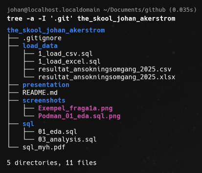
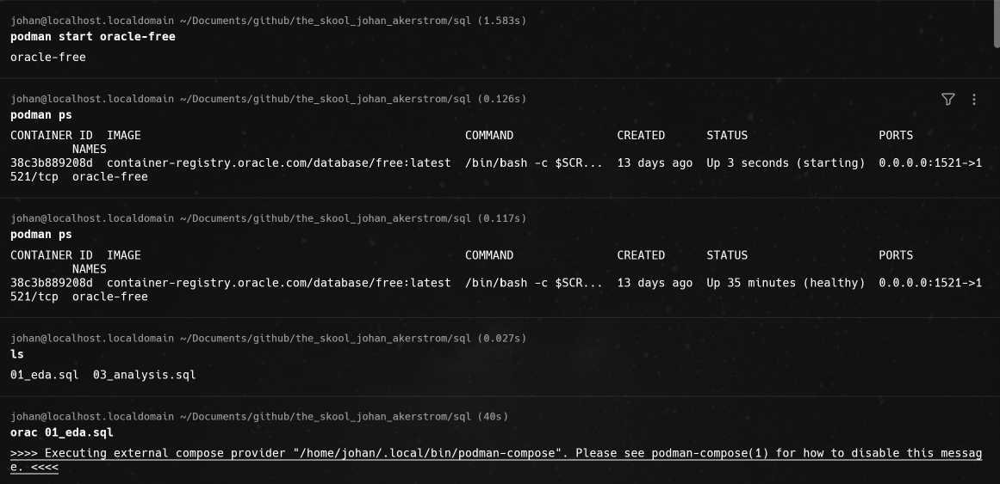
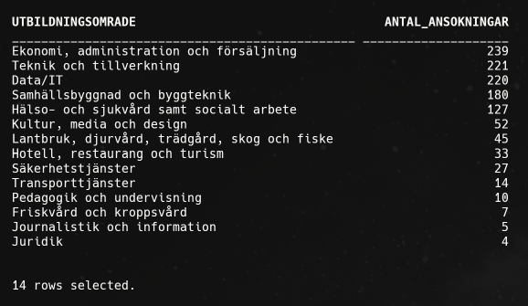

# The Skool - SQL Data Analysis
SQL1 school assignment - Data analysis using Oracle Database
"The Skool" is a fictional higher vocational education provider. In this project, I apply my knowledge of Exploratory Data Analysis (EDA)
by executing SQL queries against an Oracle Database to generate relevant insights and support data-driven decision-making.

# TL;DR
Set up an Oracle Database in a Podman container running on Oracle Linux. Imported real-world data from an Excel (.xlsx) dataset and used SQL queries to perform exploratory data analysis (EDA), identifying patterns and generating insights to support data-driven decision-making.

## 1. Project Overview
This project is part of my SQL1 course. 

The purpose of this project is to analyze applications for Swedish Higher Vocational Education (YH) programs in 2025 using SQL
and Oracle Database.

The goal is to identify patterns in approved and rejected applications and provide data-driven insights to support "The Skool" in its decision-making process. Preparing and submitting applications for new educational programs requires significant time and resources. By analyzing historical application data, this project aims to identify which educational areas and specializations have historically achieved higher approval rates.

These insights can help The Skool prioritize future applications, allocate resources more effectively, and make informed decisions about which educational programs to pursue.

# 2. Technologies used in this project
* Oracle Linux
* Oracle Database
* Podman
* SQL
* Vim
* Git and GitHub

# 3. Project Structure
The screenshot below shows the project structure.

# 4. Data import
The original dataset was provided as an .xlsx file from the Swedish National Agency for Higher Vocational Education (MYH.se) containing results from the 2025 application round.

The data was prepared and imported into Oracle Database.

The CSV import method was tested initially, but the successful import was completed using the Excel-based workflow due to load format issues.

# 5. Running SQL Queries

I'm using a custom Bash script called orac to execute SQL queries against my Oracle Database.
The script loads database credentials from a separate .env file that allows me to run SQL files directly from the Linux terminal without 
manually logging into the database each time.

The .env file is excluded from version control using .gitignore to protect sensitive credentials. 

The screenshot below shows how I start the Oracle container using Podman, verify that it is running and then execute my SQL script.

* The SQL scripts were developed and tested using Oracle Database running in a Podman container on Oracle Linux. 

* The dataset was imported into a table named ANSOKNINGAR. 

* The SQL scripts are located in the sql/ directory and executed using my custom orac Bash script.

# 6. Exploratory Data Analysis

The first analysis contains nine SQL queries covering:

Uppgift 1 - Grundläggande EDA - These queries are summarized within the 01_eda.sql script found within the sql folder of the repository.

* a. Number of applications by educational area, sorted in descending order.
* b. Number of approved applications by educational area.
* c. Number of rejected applications by educational area.
* d. Number of approved applications within Data/IT.
* e. Number of rejected applications within Data/IT.
* f. Number of approved applications by educational provider and programs within Data/IT.
* g. Top five counties by number of approved applications
* h. Distribution of distance and campus-based educations within each educational area.
* i. Number of education programs containing the word "AI" in their names.

Assignment 2 involved interviewing a domain expert to identify relevant business questions and analytical needs.

Based on insights from the interview, additional SQL queries were developed for Assignment 3 and documented in sql/03_analysis.sql.  

# 7. Example Result – Applications by Educational Area

The screenshot below shows the result of question 1a, displaying the number of applications per educational area in descending order.

# 8. AI Usage
An LLM was used as a learning aid for SQL explanations, debugging some syntax errors, and general guidance.
